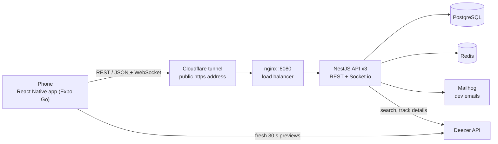

# Music Room

42 project. A mobile app to share music live with the people around you, backed by an API that holds all the data.

Services (V.2, 2 out of 3):

- **Music Track Vote**: people at a party or an event suggest tracks and vote. The most voted track goes up the list and plays first
- **Music Playlist Editor**: a playlist several people edit at the same time, in real time

## Team

- **Tony** ([42Monkey](https://github.com/42Monkey)): backend base, security, tests, load tests
- **Fega** ([prvdnx](https://github.com/prvdnx)): backend features (Google sign-in, user search, friend requests, Deezer tracks)
- **Oleg** ([olegpreed](https://github.com/olegpreed)): app account, profile, friends, Google sign-in
- **Ben** ([BenGallagh42](https://github.com/BenGallagh42)): app base, rooms, Track Vote, Playlist Editor, player

## Architecture



- the backend is the truth (V.3): rooms, tracks, votes, users live in PostgreSQL. The app keeps only the login and the backend address
- 3 copies of the API behind nginx; Redis keeps their live connections in sync
- the Cloudflare tunnel gives the backend a public https address, so any phone reaches it (school Wi-Fi, mobile data). The app's code reaches Expo Go through an ngrok tunnel

## Stack

| Part | Tech | Why |
| --- | --- | --- |
| App | React Native + Expo (TypeScript) | One codebase for iOS and Android, tested on any phone with Expo Go |
| API | NestJS (TypeScript, Node 22) | Modules, guards, interceptors and Swagger built in, same language as the app |
| Database | PostgreSQL + Prisma | Relational data (users, rooms, tracks, votes), transactions and unique constraints for concurrent votes and moves |
| Real time | Socket.io + Redis adapter | The server pushes changes; Redis shares them between the 3 API copies |
| Auth | JWT, Argon2, Google id tokens | Short sessions with renewal, hashed passwords, social login (V.1, V.5) |
| Infra | Docker Compose, nginx, Cloudflare tunnel | One command to start everything, load balancing, public https address |
| Load test | k6 | Simultaneous users scripted in JavaScript (V.7) |

## API (V.4)

- **REST**: each resource has a URL (`/rooms/:id/tracks`), the HTTP verb says the action (GET reads, POST creates, PATCH changes, DELETE removes), and every request carries its own token. Nothing is kept between requests, so any of the 3 API copies can answer, and any client understands it
- **JSON**: light, readable, native to JavaScript on both sides (NestJS and React Native), no extra parser
- **Reference**: Swagger, generated from the code, at `http://localhost:8080/docs`
- **Live events** (Socket.io): `joinRoom` / `leaveRoom` from the app, `tracks:updated` and `playback:next` from the server

## Run

Needs Docker running, `backend/.env` (copy `backend/.env.example` and fill it in) and Expo Go on the phone. Node 22.13+ is downloaded by `make` if the machine's is older.

```bash
make
```

Builds and starts the backend, creates the database and the test accounts, opens the public link, installs the app and shows the Expo QR code. Scan it with Expo Go (or press `i` for the iOS Simulator).

- test accounts: `user1@test.com` ... `user50@test.com`, password `password123` (user1 to user11 are already friends in a chain)
- iPhone: Expo Go and the Expo CLI must be signed in to the same Expo account, once per Mac: `cd mobile && npx expo login`
- backend address: printed by `make`, can be changed in the app (Server settings, V.5)
- API reference: `http://localhost:8080/docs`, emails (codes): `http://localhost:8025`

| Command | |
| --- | --- |
| `make` | start everything |
| `make down` | stop (keeps the database) |
| `make clean` / `make fclean` | stop and delete the database and installed packages |
| `make re` | full reset |
| `make test` | backend tests |
| `make k6` / `make throttle` | load test / rate limit test |
| `make help` | all commands |

## Subject checklist

| | Done |
| --- | --- |
| **V.1** User | Sign up with email + password or Google, email code, forgot password, link Google later. Profile: public info, friends-only info, private info, music genres |
| **V.2** Services | Track Vote and Playlist Editor |
| **V.2.1** Track Vote | Public by default, private rooms only found by invited people. Everyone votes by default, or invited people only, or people at a place during set hours (GPS radius + opening hours). One vote per person and track, counted in a transaction, new order pushed to everyone |
| **V.2.3** Playlist Editor | Public by default, private for invited people. Everyone edits by default, or invited people only. Each move only changes the moved track's position, the server retries on conflict and its order always wins |
| **V.3** Server | All data in PostgreSQL, the API is the reference |
| **V.4** API | REST + JSON, Swagger reference |
| **V.5** App | Remote control only, backend address configurable in the app, Google sign-in |
| **V.6** Security | See below. Every action logged with platform, device and app version (headers sent by the app on every call) |
| **V.7** Ramp-up | k6, 400 simultaneous users, machine specs in [`docs/BACKEND.md`](docs/BACKEND.md) |
| **V.8** Quality | Tests for each layer (below), credentials only in git-ignored `.env` files |
| **IV.1** Dependencies | Nothing third-party committed, everything installed by `make` |

## Security (V.6)

| Threat | Protection |
| --- | --- |
| Brute force (login, codes) | Rate limit (100 requests per minute per client on each API copy, stricter on auth routes), 6-digit codes dead after 5 wrong tries |
| Stolen database | Passwords hashed with Argon2, never stored in clear |
| Session theft | Access token 15 min, refresh token 7 days (separate types), a password reset logs out every device. On the phone: tokens encrypted, only sent to the server that issued them, `http://` refused outside the local network |
| Reading other people's data | Token required on every route except sign-up, login and password reset. Private rooms answer "Room not found" to people not invited, room rules checked on every action, friends-only and private profile fields hidden, user search returns no emails |
| Bad or extra input | Every body validated, unknown fields refused, Prisma queries (no SQL injection) |
| Fake Google sign-in | Id token checked with Google (signature, our client id), refused if the Google email isn't verified. The redirect page only forwards to the app |
| Leaked secrets | `.env` files git-ignored, only the public Google ids are copied into the app |
| Abuse after the fact | Every action logged with user, platform, device, app version |

## Tests (V.8)

- backend: `make test` (unit, integration, WebSocket)
- app: `cd mobile && npm test` (330 tests, one file per layer)

## Docs

- [`docs/BACKEND.md`](docs/BACKEND.md): API, database, auth, real time, concurrency, logs, load test
- [`mobile/README.md`](mobile/README.md): the app, how each feature works
- [`docs/FRONTEND.md`](docs/FRONTEND.md): working in the app's code
- Swagger: `http://localhost:8080/docs`
