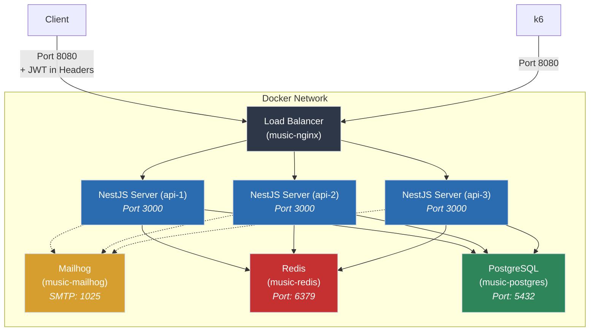
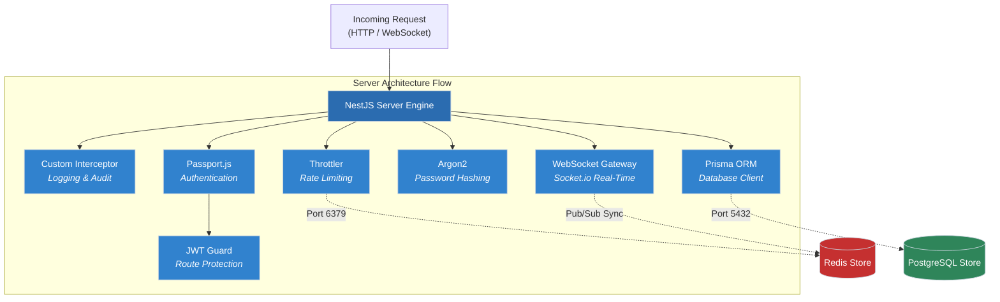

# Music Room

## Requirements

This project fulfills the mandatory requirements of the 42 **Music Room** specification, delivering a robust, custom-built NestJS backend that serves as the single source of truth for the system. The mobile client is a pure remote control: all business logic and state (scoring, position ordering, access-policy enforcement) live here, and the client's backend base URL is configurable at runtime for QA/testing, per V.5.

### V.1 User Profiles & Authentication
* **Multi-Provider Authentication:** Support for **Google OAuth 2.0** and local credential registration.
* **Credential Security:** Passwords hashed at rest using **Argon2**. Session state managed via short-lived **JWTs**.
* **Account Lifecycle:** Email verification and password reset workflows implemented via **Nodemailer** (tested locally with **Mailhog**).
* **User Preferences:** Profile customization including public/private details and musical genre preferences.

### V.2 Services (Selected 2 of 3)
* **V.2.1 Music Track Vote:**
  * Real-time live room creation with public/private visibility and location metadata (geo-fencing support).
  * Live track submission and atomic voting system powered by **Socket.io**.
  * Database-level concurrency constraints ensuring a user cannot double-vote or cause race conditions under heavy load.
* **V.2.3 Music Playlist Editor:**
  * Collaborative real-time playlist creation and track management.
  * Visibility controls (Public vs. Private) with strict owner authorization guards.

### V.4 API Design & Documentation
* **REST + JSON:** API follows REST conventions with JSON as the exchange format, chosen for broad client compatibility and NestJS's native support.
* **Self-generated documentation:** OpenAPI spec generated via `@nestjs/swagger` decorators, exposed at a `/docs` endpoint for reference by any consuming client.

### V.6 Security, Audit & Safety
* **Rate Limiting:** Global and route-specific anti-brute-force protection using `@nestjs/throttler`.
* **Action Logging:** Custom NestJS Interceptor auditing user actions, client platform, device type, and app version into PostgreSQL log records.
* **Input Sanitization:** DTO payload validation at the edge using `class-validator` and `class-transformer`.

### V.7 Performance & Ramp-Up (Benchmarking)
* **Load Testing:** Stress testing of both REST endpoints and real-time WebSocket connections using **k6** to measure and document server capacity and concurrent connection limits.

---

## Tech Stack

### Backend

| Layer / Domain | Technology / Tool | Why? | Subject Alignment |
| --- | --- | --- | --- |
| **Language & Runtime** | **TypeScript & Node.js (v22-alpine)** | Type-safe development and asynchronous I/O optimized for high-concurrency connections. | **(V.3)** |
| **Framework & Build** | **NestJS (CommonJS)** | Modular enterprise architecture avoiding ESM reflection build friction. | **(V.3)** |
| **Database** | **PostgreSQL (v15)** | Relational database providing robust ACID compliance, structured schemas, and transactional row locks. | **(V.2.1, V.2.3)** |
| **ORM & Data Access** | **Prisma (v6)** | Type-safe database client and query builder managing migrations and connection pooling under the hood. | **(V.3)** |
| **Caching, Pub/Sub & State** | **Redis (v7)** | High-performance in-memory data store for rate-limiting, session management, and Socket.io Redis Adapter to sync multi-instance WebSockets. | **(V.2.1, V.2.3, V.3)** |
| **Authentication** | **Google OAuth 2.0, JWT & Argon2** | Secure identity verification, token session handling, and modern memory-hard password hashing. | **(V.1, V.6)** |
| **Email Services** | **Nodemailer + Mailhog** | Local mail transport and SMTP capture for email verification and password reset flows. | **(V.1)** |
| **Security Hardening** | **`@nestjs/throttler`** | Rate-limiting middleware backed by Redis to protect sensitive endpoints from brute-force attacks. | **(V.6)** |
| **Lifecycle & Interception** | **NestJS Custom Interceptors** | Global interceptor capturing mobile actions to automatically log Platform, Device, and Application Version into PostgreSQL. | **(V.6)** |
| **Real-Time Layer** | **WebSockets (Socket.io) + Redis Adapter** | Low-latency bi-directional state synchronization for live rooms, track voting, control delegation, and real-time playlist editing. | **(V.2.1, V.2.3)** |
| **Input Validation** | **`class-validator` & `class-transformer`** | Native NestJS decorator-driven schema validation and payload sanitization at the API boundary. | **(V.4)** |
| **API Documentation** | **`@nestjs/swagger`** | Self-generated OpenAPI reference from existing controllers/DTOs to document inputs and outputs. | **(V.4)** |
| **Testing** | **Jest** | Native NestJS unit and integration testing runner ensuring isolated validation for each layer. | **(V.8)** |
| **Containerization** | **Docker & Docker Compose** | Multi-container environment orchestration (`api` + `postgres` + `redis` + `mailhog`). | **(V.3, V.7)** |
| **Benchmarking** | **k6 (by Grafana)** | Modern load-testing tool capable of measuring simultaneous multi-user capacity across the core services. | **(V.7)** |

### Project Infrastructure Architecture

### Server Internal Flow

